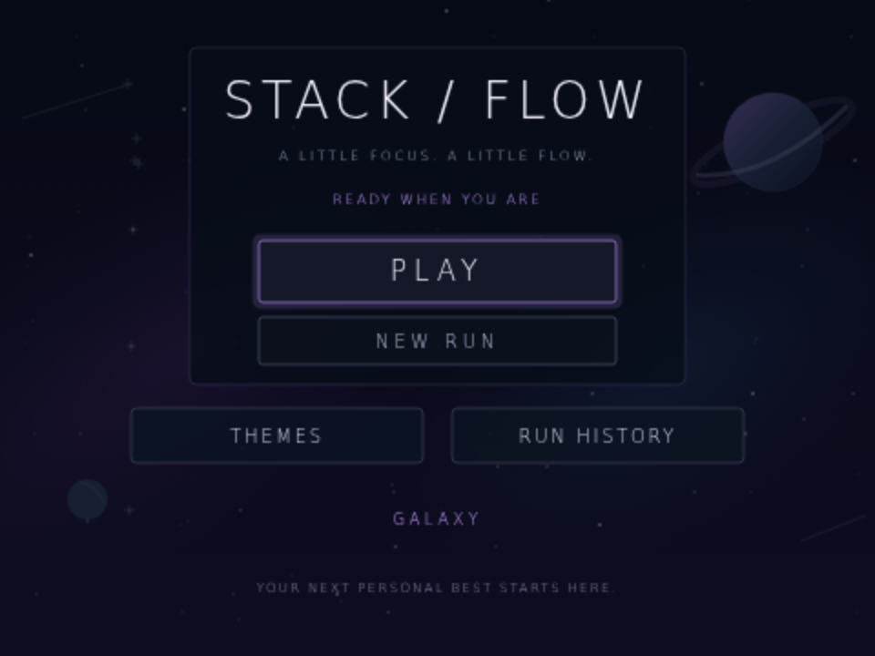
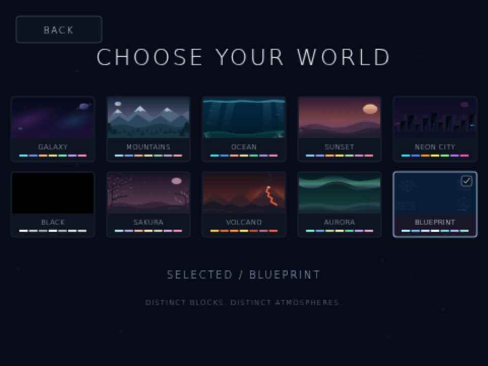
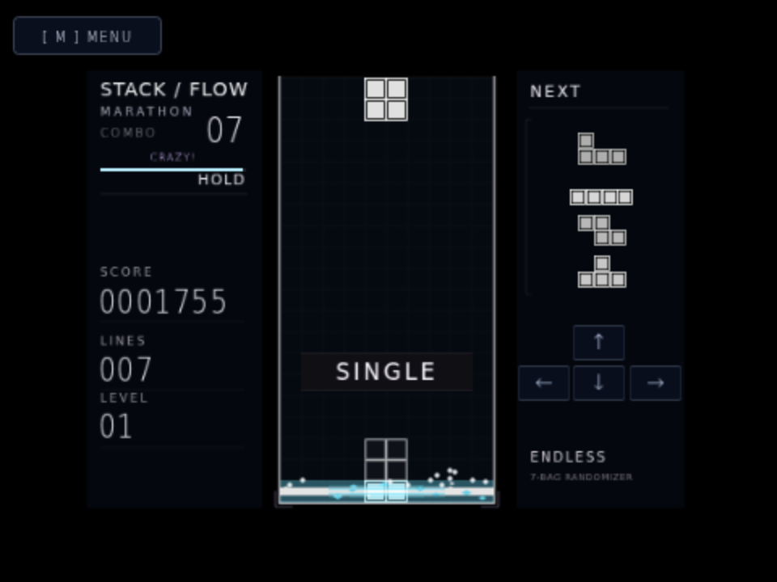
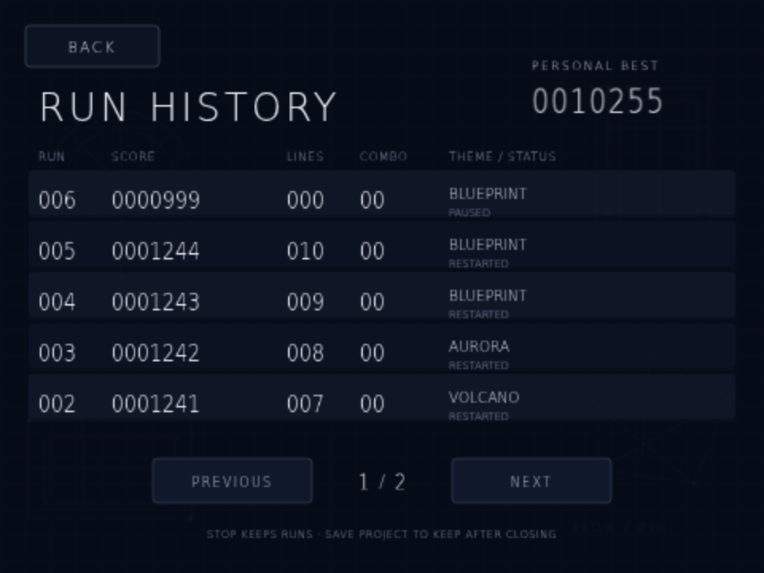

# Stack / Flow — Scratch edition

A single-player falling-block game inspired by TETR.IO's minimal competitive layout, built with editable native Scratch 3 blocks and original embedded vector artwork.

**[Download the game](https://github.com/vnanzero-crypto/tetris-on-scratch/blob/main/stack-flow.sb3)** — click **Download raw file** (↓), then open [Scratch](https://scratch.mit.edu/projects/editor/) and choose **File → Load from your computer**. Click the green flag to open the main menu, choose a theme, then click **Play**.




## Main menu and pausing

The green flag opens the main menu with **Play/Resume**, **New Run**, **Themes**, and **Run History**. Press **Space** for Play/Resume or **N** for a new run. Click **Themes** (or press T) to open the dedicated ten-theme gallery; click **Run History** (or press H) to compare saved runs. Each submenu has a Back button; M also returns to the main menu.

During play or after game over, press **M** or click the upper-left **Menu** button to return. The menu pauses the board, falling piece, effects, and combo countdown; **Resume** restores the same run and remaining combo time. **New Run** starts over with the chosen theme. Finished runs cannot be resumed. M also resumes an available run from the menu.

## Controls

| Key | Action |
| --- | --- |
| A / D or Left / Right | Move left / right, with automatic repeat |
| S or Down | Soft drop |
| W or Up | Rotate clockwise |
| Z | Rotate counterclockwise |
| Space | Hard drop |
| C | Hold / swap once per piece |
| R | Restart |
| M / Menu button | Return to main menu |
| T / Themes button | Open the theme gallery; T cycles while inside |
| 1–9 / 0 | Select theme 1–9 / 10 inside the theme gallery |
| H / Run History button | Open saved scores from the main menu |

Both WASD and arrows work. Holding W or Up makes one clockwise rotation; release both and press again for another rotation. The live input display shows only ↑ above ← ↓ →, like a physical keyboard. Matching WASD actions also light the corresponding arrow. Gameplay control hints are hidden to keep the screen clear.

## Scoring

Each successful rotation awards **5 points**; a blocked rotation awards nothing. Soft drop awards 1 point per cell and hard drop awards 2 points per cell.

| Lines cleared | Normal clear | T-spin |
| --- | --- | --- |
| 0 | 0 | 400 |
| 1 | 100 | 800 |
| 2 | 300 | 1,200 |
| 3 | 500 | 1,600 |
| 4 | 800 | — |

Clear and T-spin scores are multiplied by the current level, before updating the level. T-spin scores replace normal line-clear scores; the rotation's 5 points are additional. A T-spin requires a T piece whose last successful horizontal/rotation action was a rotation and at least three occupied corners around its center when it locks. Walls and floor count as occupied. Successful horizontal movement, spawning, and hold reset spin eligibility; failed movement and vertical drops preserve it. This is a simplified three-corner rule without separate mini-T-spin or SRS kick classifications.

## Combos, camera, and themes

Clear again within **four seconds** to increase COMBO. The first clear starts at 1; each new clear refreshes the timer. Non-clearing placements do not break the chain while time remains. After four seconds without a clear, the counter resets. The combo count is back in the left sidebar, with a brief pop and a named milestone. A shrinking bar below the name shows the remaining time. The pulse finishes after 24 rendered frames; the count and name stay until expiry. Names are capped at the final milestone after 15, while the numerical combo and bonuses can keep growing.

Combo bonus per clear is **50 × (COMBO − 1) × level**, in addition to line-clear or T-spin points. The first clear has no extra combo bonus. Restarting or topping out resets the combo.

A line clear gives the game view a brief, decaying shake of at most 1.6 pixels horizontally and 0.8 vertically. The game view is rendered at **82% scale**; the logical board and collision rules stay the same. The themed landscape remains steady.

Open **Themes** from the main menu. Select one of the ten illustrated cards, use **1–9 / 0** for themes 1–10, or press **T** to cycle. Changing themes preserves the board, score, and combo, and restarting retains the chosen theme.

| Key | Theme | Background and block style |
| --- | --- | --- |
| 1 | [Galaxy](docs/theme-1.png) | Nebulae, stars, ringed planet; shimmering blocks |
| 2 | [Mountains](docs/theme-2.png) | Snowy peaks, pines and moon; faceted blocks |
| 3 | [Ocean](docs/theme-3.png) | Underwater light rays, fish and coral; wave blocks |
| 4 | [Sunset](docs/theme-4.png) | Warm sun, dunes and palms; striped blocks |
| 5 | [Neon City](docs/theme-5.png) | Night skyline, glowing windows and grid; neon-bordered blocks |
| 6 | [Black](docs/theme-6.png) | Pure black backdrop; stark monochrome blocks |
| 7 | [Sakura](docs/theme-7.png) | Cherry blossoms and drifting petals; floral tiles |
| 8 | [Volcano](docs/theme-8.png) | Lava and embers; cracked molten tiles |
| 9 | [Aurora](docs/theme-9.png) | Northern lights over ice; flowing ribbon tiles |
| 0 | [Blueprint](docs/theme-10.png) | Technical grid and drafting shapes; outlined schematic tiles |



| Combo | Name |
| --- | --- |
| 1 | START! |
| 2 | KEEP IT UP! |
| 3 | NICE! |
| 4 | SMOOTH! |
| 5 | GREAT! |
| 6 | ON FIRE! |
| 7 | CRAZY! |
| 8 | WILD! |
| 9 | UNREAL! |
| 10 | INSANE! |
| 11 | PHENOMENAL! |
| 12 | UNSTOPPABLE! |
| 13 | LEGENDARY! |
| 14 | GODLIKE! |
| 15+ | BEYOND LIMITS! |



## Saved runs and personal best

Run History keeps the newest **20 runs**, five per page, and a personal best that is not reduced when older records are trimmed. Each row includes run number, score, cleared lines, highest combo reached, last-used theme, and status. Current runs are checkpointed every frame. Restarting archives the previous run; game over finalizes it; restarting the green flag after Stop marks its last record as Stopped without duplicating it.

**Stop and green-flag restarts retain history in the loaded project. To retain it after closing Scratch, save your own Scratch project or download the played project as an `.sb3`, then reopen that saved version.** Native Scratch does not automatically write browser-local storage or silently save a viewer's account. Loading a fresh original download replaces the current project's data, including its local run history. This is personal project data, not an online leaderboard.



## Features

10×20 board, seven-bag randomization, four-piece remaining-bag preview, hold, ghost piece, wall/floor kicks, lock delay, line clearing, and increasing gravity every ten lines. The next preview shortens until the next seven-piece bag is generated.

Line clears launch an animated light sweep across the actual cleared rows and 12 moving sparks per row. Four-line clears and T-spin clears use purple highlights; effects fade and expire after 24 rendered frames. T-spins and line clears show distinct callouts.

The artwork is original and TETR.IO-inspired. This is not an affiliated release or a full reproduction: there are no online multiplayer services, accounts, rankings, replays, exact SRS tables, exact TETR.IO scoring, or back-to-back bonuses.

## Build and validate

Python 3.10+ builds the project without Python dependencies or network access:

```sh
python3 tools/build.py
```

The builder writes `dist/stack-flow.sb3`, containing the Scratch blocks and all 261 SVG assets. `stack-flow.sb3` at the repository root is the published download; after rebuilding, copy the output there when preparing a release.

To run the gameplay checks with dependencies outside the checkout:

```sh
npm install --prefix /tmp/stack-flow-check scratch-vm@5.0.300 scratch-storage@4.1.27 --no-audit --no-fund
NODE_PATH=/tmp/stack-flow-check/node_modules node tools/check.cjs
```

All 132 Scratch VM assertions passed, covering board state, collisions, movement, rotation scoring, hold, T-spin eligibility and bonuses, ordinary and four-line clears, animation row tracking/expiry, four-second combo boundaries and bonus scoring, camera shake limits and settling, all ten theme palettes and backdrops, theme cycling, preserved game state, menu pause/resume and new-run behavior, paused combo deadlines, sidebar animation lifecycle, combo milestone names, game over, capped/aligned score history, monotonic personal best, Stop/green-flag persistence, and actual `.sb3` save/reload roundtrips. Headless tests intentionally omit a renderer and may emit costume-renderer warnings.

Chromium checks separately exercised the dedicated theme gallery and all ten cards, 0 for theme ten, cycling, pure Black gameplay, arrow-only input highlighting and physical layout, real clear chains through 15 with the requested milestone names, personal-best checkpointing, Stop/green-flag score preservation, history paging, and export/reload of played history. Earlier browser checks also exercised both WASD and arrows, menu pause/resume, and key edge handling. Previews use scripted board and score fixtures.
