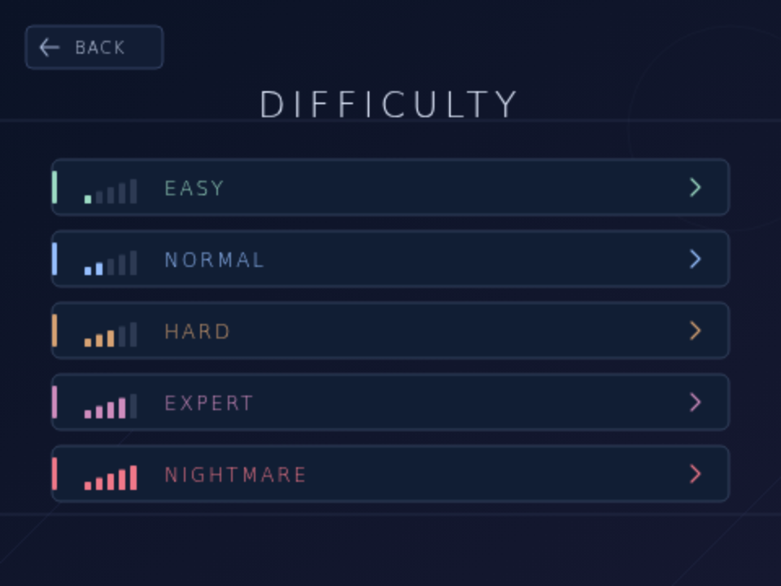
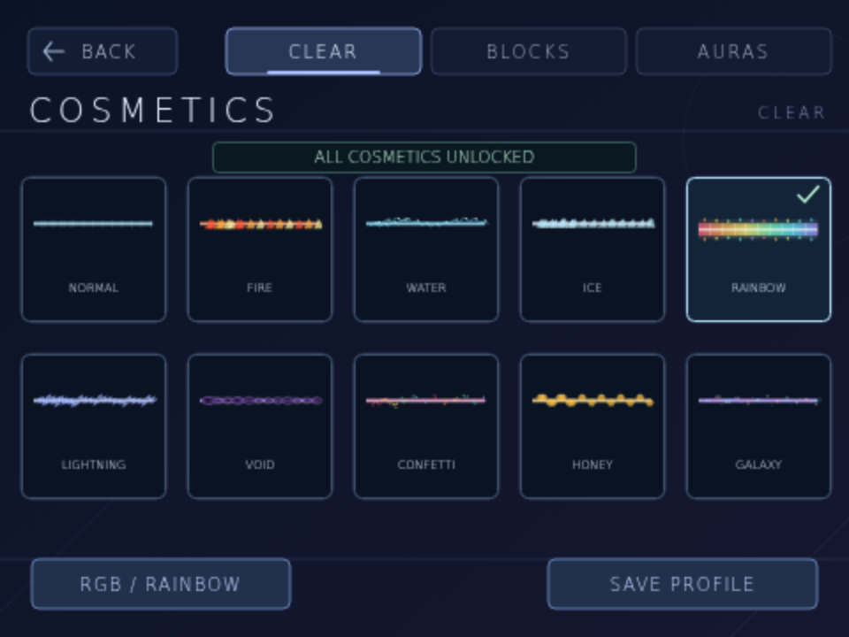
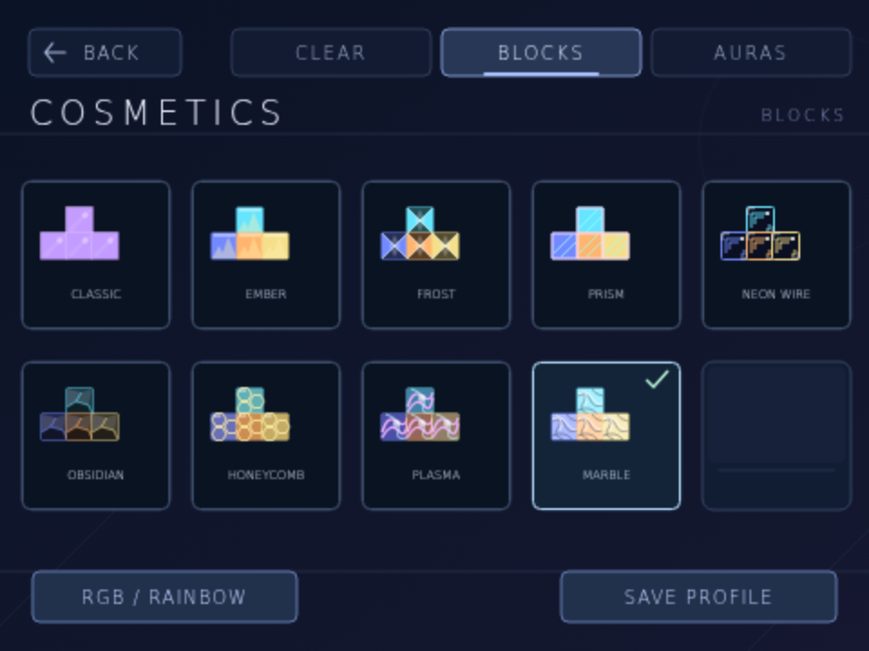
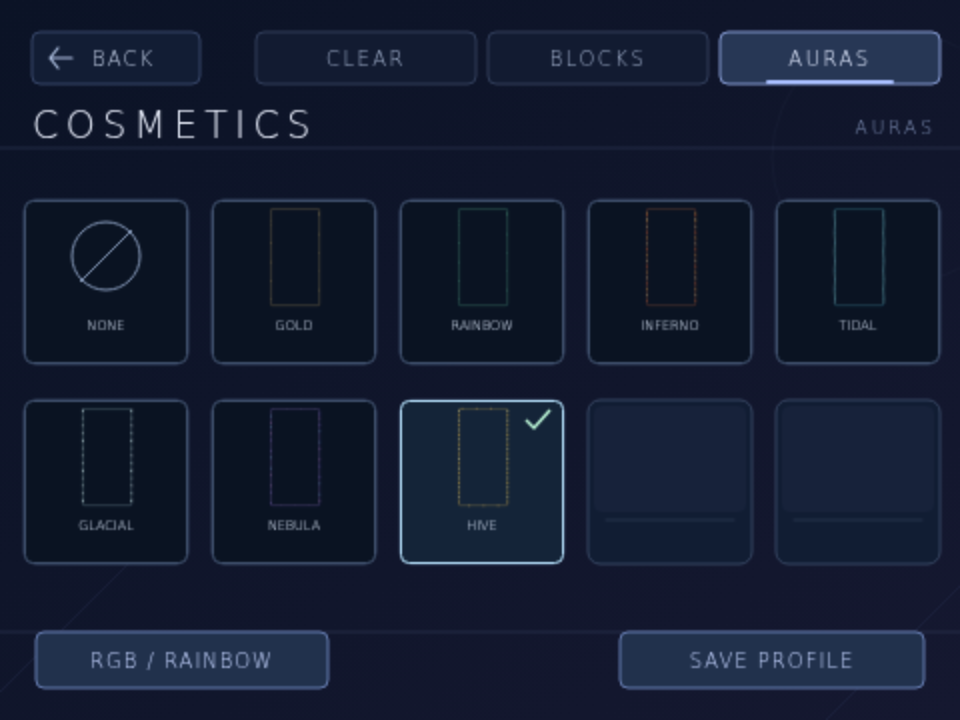
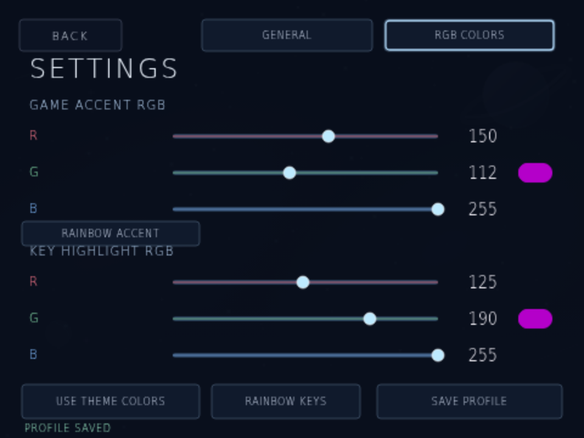
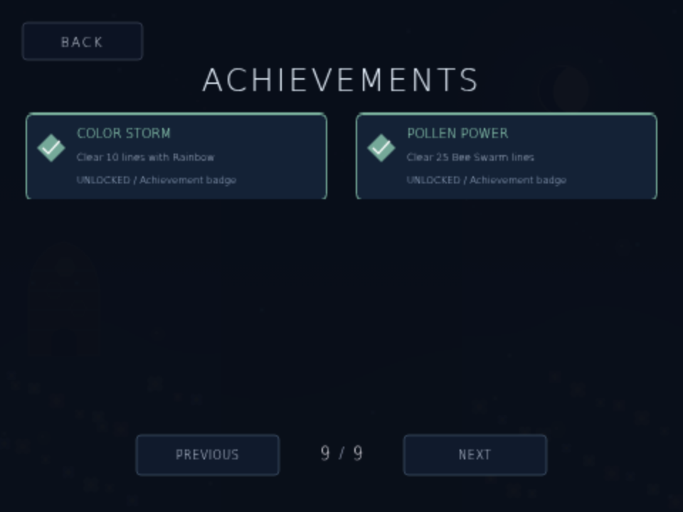
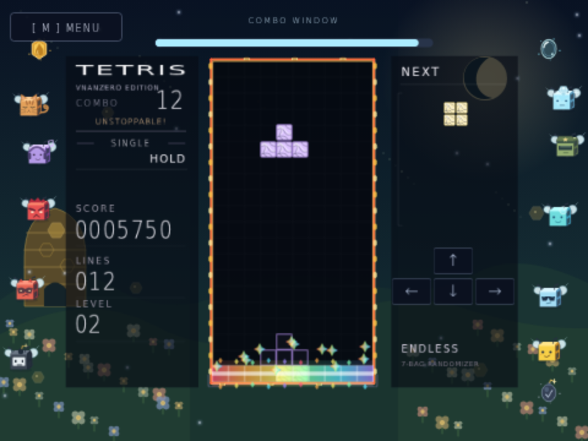
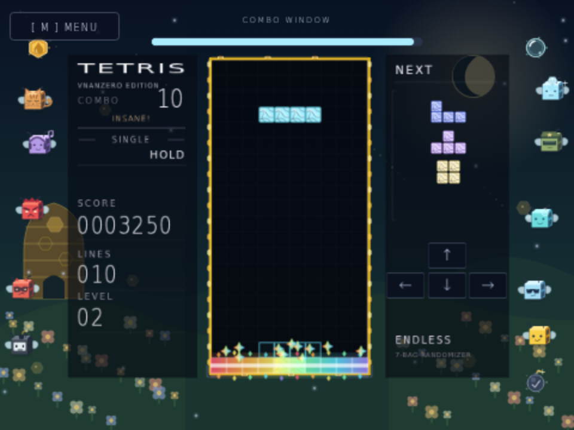

# Tetris Vnanzero Edition

A single-player falling-block game with editable native Scratch 3 blocks and original embedded vector artwork, inspired by TETR.IO’s competitive layout.

**[Download Tetris Vnanzero Edition](https://github.com/vnanzero-crypto/tetris-on-scratch/blob/main/tetris-vnanzero-edition.sb3)** — click **Download raw file** (↓), then open [Scratch](https://scratch.mit.edu/projects/editor/) and choose **File → Load from your computer**. Click the green flag, choose **Play**, and select a difficulty.

The older `stack-flow.sb3` download is kept as an identical compatibility copy.


## Menu and controls

The main menu contains **Play/Resume**, **New Run**, **Themes**, **Run History**, **Cosmetics**, **Settings**, and **Achievements**. Play and New Run open a difficulty picker. Resume immediately continues the existing run. **Space** plays/resumes and **N** opens the new-run picker from the menu.

During play or after game over, press **M** or click the upper-left **Menu** button to return. The menu pauses the board, falling piece, effects, and combo countdown. Resume restores the same run and remaining combo time. Cancelling the difficulty picker preserves a resumable run; choosing a difficulty starts over. Finished runs cannot be resumed.

| Key | Action |
| --- | --- |
| A / D or Left / Right | Move left / right, with automatic repeat |
| S or Down | Soft drop |
| W or Up | Rotate clockwise |
| Z | Rotate counterclockwise |
| Space | Hard drop |
| C | Hold / swap once per piece |
| R | Open the new-run difficulty picker |
| M / Menu button | Return to main menu |
| T / Themes button | Open the theme gallery; T cycles while inside |
| 1–9 / 0 / B | Select theme 1–9 / 10 / 11 inside the gallery |
| H / Run History button | Open saved scores from the main menu |
| U | Unlock all 50 achievements and every cosmetic |

Holding W or Up makes one clockwise rotation; release both and press again for another rotation. The live input display shows only ↑ above ← ↓ →, like a physical keyboard. Matching WASD actions light the corresponding arrow. Gameplay control hints are hidden.

Hovering menu actions reveals animated related objects; theme cards have their own previews. Twenty-four decorative motes drift around menus and outside the playfield. These visual effects do not change the board, score, or input.

## Five difficulties

Choose a difficulty whenever you start a new run. Settings also holds your preferred difficulty. Changing that preference leaves an existing run’s timing intact; history records the actual mode used.

| Difficulty | Gravity interval at level 1 | Lock delay |
| --- | --- | --- |
| Easy | 60 update ticks | 35 ticks |
| Normal | 35 update ticks | 25 ticks |
| Hard | 15 update ticks | 12 ticks |
| Expert | 8 update ticks | 8 ticks |
| Nightmare | 3 update ticks | 5 ticks |

Gravity accelerates with level. All five modes use the same scoring rules.



## Cosmetics, RGB, and settings

Open **Cosmetics** to preview and equip clear effects, block styles, and board auras. Locked cards are marked; Achievements lists the requirements for their rewards. **RGB / Rainbow** opens the color controls, and **Save Profile** commits the selected appearance.

| Category | Available choices |
| --- | --- |
| Clear effects — 10 | Normal, Fire, Water, Ice, Rainbow, Lightning, Void, Confetti, Honey, Galaxy |
| Block styles — 9 | Classic, Ember, Frost, Prism, Neon Wire, Obsidian, Honeycomb, Plasma, Marble |
| Auras — 7 plus None | Gold, Rainbow, Inferno, Tidal, Glacial, Nebula, Hive |

Normal, Fire, Water, Ice, and Rainbow clears are available immediately. The five added clear effects and all non-default block styles and auras are achievement rewards. Classic uses the selected theme’s seven piece colors and textures.

Rainbow clears have a **160 × 32** logical-pixel spectrum spanning all ten board columns, with larger prism sparks. Every clear style follows the actual cleared rows and fades after 24 rendered frames.







**Settings → General** includes name entry, shake intensity/Off, and preferred difficulty. The name accepts up to twelve letters, numbers, spaces, hyphens, or underscores through Scratch’s normal answer prompt.

**RGB Colors** independently customizes the game accent/well border and pressed-arrow highlights. Drag the R/G/B sliders or click a channel value to enter an integer from 0 to 255. Each has an animated **Rainbow** mode; the stored solid RGB values remain available when you switch back. **Use Theme Colors** restores both theme defaults. Accent controls leave the seven piece colors intact.



## 50 achievements

Achievements track lifetime lines, best score, combos, four-line clears, T-spins, successful rotations, hard drops, runs, bee counts, harder-mode starts, Rainbow clears, and Bee Swarm lines. The menu has nine pages with requirements, reward names, and permanent unlock states. The full catalogue and reward mappings are in [tools/progression.py](tools/progression.py).

The original six rewards remain: First Clear earns Ember blocks; Ten Lines earns Frost; combo 5 earns Prism; a four-line clear earns the Gold aura; a T-spin earns the Spin Artist title; 5,000 points earns the Rainbow aura. New rewards include Lightning clears at combo 7, Honey clears for your first bee, and the Hive aura for ten bees.

Press **U** to unlock all 50 achievements, every cosmetic, and the title immediately. This shortcut changes unlock flags only; it does not add points, lines, or lifetime progress.



## Combos and camera

Clear again within **four seconds** to increase COMBO. The first clear starts at 1; each clear refreshes the timer. Non-clearing placements do not break the chain while time remains. After four seconds without a clear, the counter resets.

The count, milestone name, and clear captions appear in the left sidebar. A larger **220-pixel countdown bar above the board** shows the remaining combo window without covering the cells. The milestone briefly pops for 24 rendered frames. Names stop changing after 15, while the numerical combo and bonuses can keep growing.

| Combo | Name | Combo | Name | Combo | Name |
| --- | --- | --- | --- | --- | --- |
| 1 | START! | 6 | ON FIRE! | 11 | PHENOMENAL! |
| 2 | KEEP IT UP! | 7 | CRAZY! | 12 | UNSTOPPABLE! |
| 3 | NICE! | 8 | WILD! | 13 | LEGENDARY! |
| 4 | SMOOTH! | 9 | UNREAL! | 14 | GODLIKE! |
| 5 | GREAT! | 10 | INSANE! | 15+ | BEYOND LIMITS! |

Combo bonus per clear is **50 × (COMBO − 1) × level**, in addition to line-clear or T-spin points. Restarting or topping out resets the combo.

A line clear triggers a decaying shake. Settings provides a 0–100 slider and Off: default 50 reaches 4 pixels horizontally and 2 vertically; 100 reaches 8 and 4; zero disables camera movement. The game view uses **82% scale** while collision rules retain their logical dimensions. The landscape remains steady.



## Eleven themes

Open **Themes** and select a card in the three-row gallery. Use **1–9 / 0 / B** for themes 1–11, or **T** to cycle. Changing themes preserves the board, score, and combo; a new run retains the chosen theme.

| Key | Theme | Background and blocks |
| --- | --- | --- |
| 1 | Galaxy | Nebulae, stars, ringed planet; shimmering blocks |
| 2 | Mountains | Snowy peaks, pines and moon; faceted blocks |
| 3 | Ocean | Underwater light rays, fish and coral; wave blocks |
| 4 | Sunset | Warm sun, dunes and palms; striped blocks |
| 5 | Neon City | Night skyline and glowing grid; neon-bordered blocks |
| 6 | Black | Pure black backdrop; monochrome blocks |
| 7 | Sakura | Cherry blossoms and petals; floral tiles |
| 8 | Volcano | Lava and embers; cracked molten tiles |
| 9 | Aurora | Northern lights over ice; flowing ribbon tiles |
| 0 | Blueprint | Drafting grid; schematic tiles |
| B | Beeswarm Sim Theme | Flower fields, hive, honey tokens; honeycomb blocks |


**Beeswarm Sim Theme** adds one flying bee per line cleared in the current run, up to ten. Original fan artwork depicts Basic, Bomb, Cool, Rascal, Bubble, Rage, Commander, Music, Diamond, and Tabby bees. They fly along the outer edges, outside the board. Honey, bubble, and bomb token effects accompany clears. The bees and tokens are decorative; lines, scoring, and collisions remain unchanged.



## Scoring and gameplay

The game has a 10×20 board, seven-bag randomization, a four-piece remaining-bag preview, hold, ghost piece, wall/floor kicks, lock delay, and increasing gravity every ten lines. The next preview shortens until the next bag is generated.

Each successful rotation awards **5 points**; blocked rotations award nothing. Soft drop awards 1 point per cell and hard drop 2 points per cell.

| Lines cleared | Normal clear | T-spin |
| --- | --- | --- |
| 0 | 0 | 400 |
| 1 | 100 | 800 |
| 2 | 300 | 1,200 |
| 3 | 500 | 1,600 |
| 4 | 800 | — |

Clear and T-spin scores are multiplied by the current level before updating it. T-spin scores replace normal clear scores; rotation points are additional. A T-spin requires a T piece whose last successful horizontal/rotation action was rotation and at least three occupied corners around its center on locking. Walls and floor count as occupied. Successful horizontal movement, spawning, and hold reset eligibility; failed movement and vertical drops preserve it. This uses a simplified three-corner rule without separate mini-T-spin or exact SRS classifications.

The artwork is original and TETR.IO-inspired. Online multiplayer, rankings, and replay services are outside this single-player Scratch project.

## Saving your name, preferences, and runs

**Save Profile** stores the name, shake, preferred difficulty, equipped cosmetics, RGB values, and rainbow/theme switches inside the loaded project. A **PROFILE SAVED** confirmation appears. The next green flag restores that snapshot; unsaved settings can be replaced by the last saved profile. Scores and earned progress are recorded independently.

**Run History** retains the newest **20 runs**, five per page, plus a personal best that never decreases when older records are trimmed. Rows include run number, score, lines, highest combo, last-used theme, status, and difficulty. A run is checkpointed during play and finalized on restart or game over. Stop followed by the green flag marks its last record Stopped without duplicating it.

**Stop and green-flag restarts preserve data in the loaded project. To keep it after closing Scratch, save your own Scratch project or download the played `.sb3`, then reopen that saved version.** Save Profile does not silently save your Scratch account, browser storage, or a Windows file. Loading a fresh original download replaces the loaded project’s data, so save your played version first if you want to retain it.

## Build and validate

Python 3.10+ builds the project without Python dependencies or network access:

```sh
python3 tools/build.py
```

The builder writes `dist/tetris-vnanzero-edition.sb3` and the identical `dist/stack-flow.sb3`. The current archive contains **6,287 Scratch blocks and 984 unique SVG assets**. Copy the built archive to both root filenames when preparing a release.

Run the native gameplay checks with dependencies outside the checkout:

```sh
npm install --prefix /tmp/tetris-check scratch-vm@5.0.300 scratch-storage@4.1.27 --no-audit --no-fund
NODE_PATH=/tmp/tetris-check/node_modules node tools/check.cjs
```

All **301 Scratch VM assertions** passed, including movement and scoring, timed combos, pause/resume, all eleven themes, five difficulty timings, the 50-entry achievement catalogue, cosmetic locks and unlocks, RGB/rainbow modes, bee limits, history alignment, and Save Profile serialization. Headless checks omit a renderer and can emit costume-renderer warnings.

Chromium also verified real menu clicks, the difficulty picker and instant Resume, every cosmetic choice, all achievement pages, U without fake scores, rainbow colors, one bee per line capped at ten outside gameplay, the timer above the board, and Stop/green-flag plus actual exported `.sb3` reload persistence. Screenshots use scripted board and score fixtures.
