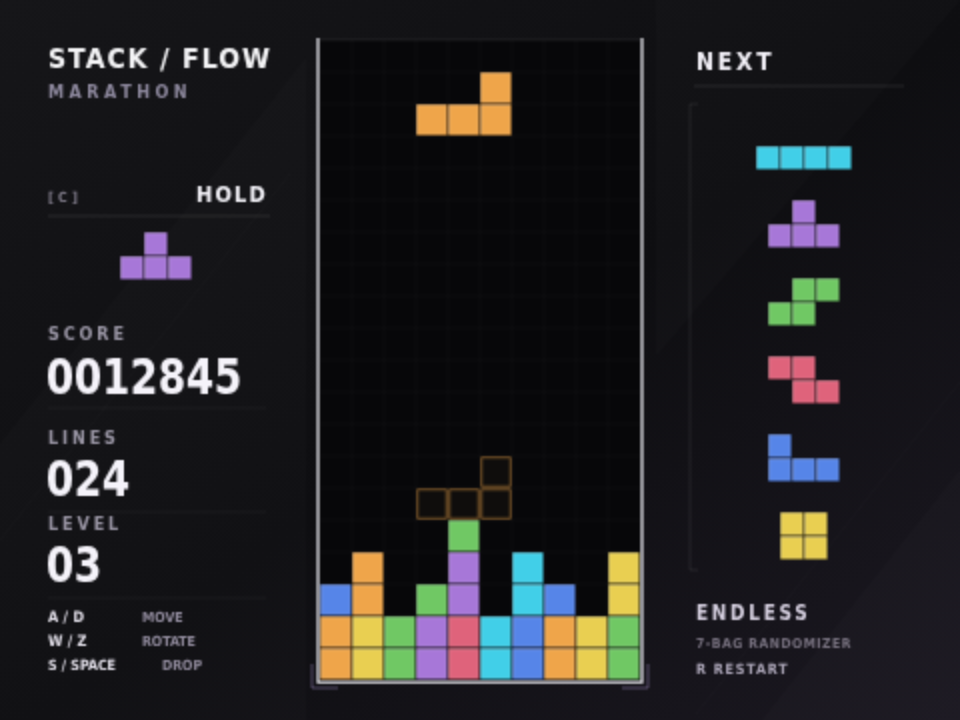
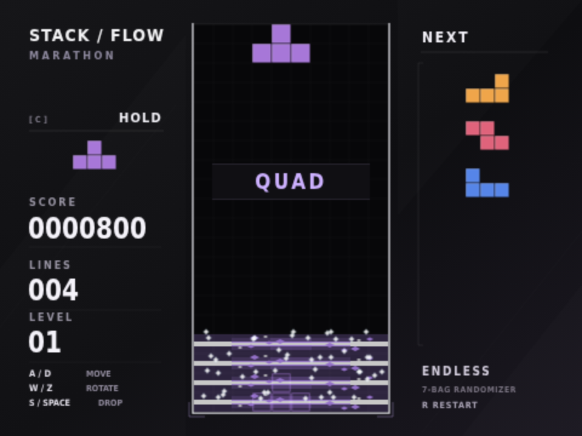

# Stack / Flow — Scratch edition

A single-player falling-block game inspired by TETR.IO's minimal competitive layout, built with editable native Scratch 3 blocks and original embedded vector artwork.

**[Download the game](https://github.com/vnanzero-crypto/tetris-on-scratch/blob/main/stack-flow.sb3)** — click **Download raw file** (↓), then open [Scratch](https://scratch.mit.edu/projects/editor/) and choose **File → Load from your computer**. Click the green flag to play.



## Controls

| Key | Action |
| --- | --- |
| A / D | Move left / right, with automatic repeat |
| S | Soft drop |
| W | Rotate clockwise |
| Z | Rotate counterclockwise |
| Space | Hard drop |
| C | Hold / swap once per piece |
| R | Restart |

Arrow keys are no longer bound. Holding W makes one rotation; release and press again for another rotation.

## Scoring

Each successful rotation awards **5 points**; a blocked rotation awards nothing. Soft drop awards 1 point per cell and hard drop awards 2 points per cell.

| Lines cleared | Normal clear | T-spin |
| --- | --- | --- |
| 0 | 0 | 400 |
| 1 | 100 | 800 |
| 2 | 300 | 1,200 |
| 3 | 500 | 1,600 |
| 4 | 800 | — |

Clear and T-spin scores are multiplied by the current level, before updating the level. T-spin scores replace normal line-clear scores; the rotation's 5 points are additional. A T-spin requires a T piece whose last successful horizontal/rotation action was a rotation and at least three occupied corners around its center when it locks. Walls and floor count as occupied. Successful horizontal movement, spawning, and hold reset spin eligibility; failed movement and vertical drops preserve it. This is a simplified three-corner rule without separate mini-T-spin or SRS kick classifications.

## Features

10×20 board, seven-bag randomization, remaining-bag preview, hold, ghost piece, wall/floor kicks, lock delay, line clearing, and increasing gravity every ten lines. The next preview shortens until the next seven-piece bag is generated.

Line clears launch an animated light sweep across the actual cleared rows and 12 moving sparks per row. Four-line clears and T-spin clears use purple highlights; effects fade and expire after 24 rendered frames. T-spins and line clears show distinct callouts.



The artwork is original and TETR.IO-inspired. This is not an affiliated release or a full reproduction: there are no online multiplayer services, accounts, rankings, replays, exact SRS tables, or combo/back-to-back bonuses.

## Build and validate

Python 3.10+ builds the project without Python dependencies or network access:

```sh
python3 tools/build.py
```

The builder writes `dist/stack-flow.sb3`, containing the Scratch blocks and all 52 SVG assets. `stack-flow.sb3` at the repository root is the published download; after rebuilding, copy the output there when preparing a release.

To run the gameplay checks with dependencies outside the checkout:

```sh
npm install --prefix /tmp/stack-flow-check scratch-vm@5.0.300 scratch-storage@4.1.27 --no-audit --no-fund
NODE_PATH=/tmp/stack-flow-check/node_modules node tools/check.cjs
```

All 27 Scratch VM assertions passed, covering board state, collisions, movement, rotation scoring, hold, T-spin eligibility and bonuses, ordinary and four-line clears, animation row tracking/expiry, and game over. Headless tests intentionally omit a renderer and may emit costume-renderer warnings.

Chromium checks separately exercised A/D/S/W/Z, removal of arrow bindings, key edge handling, hold, hard drop, an actual W-and-Space T-spin, and the rendered four-line effect. Preview screenshots use deterministic board fixtures.
